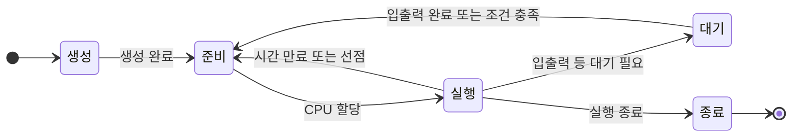

# 프로세스와 스레드

학습 날짜: 2026-10-22 (KST)

## 1. 프로세스 개요

- **프로세스(Process)**: 실행 중인 프로그램. **프로세서(Processor)**는 명령어를 실행하는 CPU를 뜻한다.
- 유닉스 계열에서는 `ps`로 프로세스를 확인한다.
- **포그라운드 작업**: 터미널에서 입력을 받으며 사용자와 상호작용하는 작업.
- **백그라운드 작업**: 포그라운드와 별개로 실행되는 작업. 화면 출력 여부만으로 구분하지 않는다.
- 유닉스의 데몬과 윈도우의 서비스는 백그라운드에서 기능을 제공하는 대표적인 형태다. 모든 백그라운드 프로세스가 데몬이나 서비스는 아니다.

## 2. PCB와 문맥 교환

**프로세스 제어 블록(PCB)**은 운영체제가 프로세스를 관리하기 위해 커널에서 유지하는 자료 구조다. 생성 시 마련되고, 종료 후 필요한 정리가 끝나면 해제된다.

| 주요 정보 | 내용 |
| --- | --- |
| 식별 정보 | PID, 부모 PID(PPID) 등 |
| 실행 문맥 | 프로그램 카운터, 레지스터 값 등 |
| 상태와 스케줄링 정보 | 준비·실행·대기 상태, 우선순위 등 |
| 메모리 관리 정보 | 주소 공간, 페이지 테이블 관련 정보 등 |
| 자원 정보 | 열린 파일과 입출력 자원 관련 정보 등 |

- **문맥(Context)**: 중단한 실행을 재개하기 위해 필요한 정보.
- **문맥 교환**: 현재 작업의 문맥을 저장하고 다음 작업의 문맥을 복원하는 과정. 저장·복원 비용이 발생한다.
- PCB는 문맥 자체가 아니라 문맥 등을 담거나 참조하는 관리 구조다. 실제 저장 방식은 운영체제에 따라 다르다.
- CPU 할당과 선점은 스케줄링 정책에 따른다. 모든 작업이 항상 같은 시간만큼 실행되는 것은 아니다.

## 3. 프로세스의 메모리 영역

사용자 주소 공간의 대표적인 구분은 다음과 같다.

| 영역 | 저장 내용 | 특징 |
| --- | --- | --- |
| 코드(Text) | 실행할 명령어 | 일반적으로 읽기·실행을 허용하고 쓰기를 제한 |
| 데이터·BSS | 전역 변수, 정적 변수 등 | 프로그램 실행 동안 유지 |
| 힙(Heap) | 동적으로 할당한 메모리 | 실행 중 필요에 따라 할당·해제 |
| 스택(Stack) | 함수 호출 정보, 지역 변수 등 | 함수 호출·반환에 따라 사용 공간 변화 |

- 기본 모델에서 코드·데이터는 크기가 비교적 고정되고, 힙·스택은 사용량이 변한다. 실제 배치와 변수 저장 위치는 구현에 따라 다르다.
- C의 `malloc()`으로 확보한 메모리는 사용 후 `free()`로 해제한다. 불필요한 메모리가 회수되지 않고 남으면 **메모리 누수**가 발생한다.
- 가비지 컬렉션 등 자동 메모리 관리 기능이 있는 언어는 회수 방식이 다르다.

## 4. 프로세스 상태와 전이

| 상태 | 의미 |
| --- | --- |
| 생성(New) | 프로세스 생성에 필요한 자원과 관리 정보 준비 |
| 준비(Ready) | 실행 준비를 마치고 CPU 할당 대기 |
| 실행(Running) | CPU를 할당받아 명령어 실행 |
| 대기(Waiting / Blocked) | 입출력 완료 등 특정 조건 충족 대기 |
| 종료(Terminated) | 실행이 끝나 자원 정리 대상이 된 상태 |

- **준비는 CPU를**, **대기는 실행에 필요한 사건을** 기다린다. 대기 조건이 충족되어도 CPU를 다시 할당받아야 실행된다.
- 위 그림은 기본 5상태 모델이다. 실제 운영체제에는 정지 등 추가 상태가 있다.
- 유닉스 계열에서는 종료 후에도 부모가 종료 정보를 수거할 때까지 일부 관리 정보가 남는 **좀비 상태**가 생길 수 있다.

## 5. 프로세스 계층과 생성

- 새 프로세스를 만든 쪽은 **부모**, 생성된 쪽은 **자식**이다. 서로 다른 PID를 가지며, 부모·자식 관계는 트리 구조를 이룬다.
- 전통적인 유닉스의 사용자 공간 시작 프로세스는 `init`, 많은 리눅스 배포판은 `systemd`, macOS는 `launchd`다. 리눅스의 init 시스템은 배포판에 따라 다르다.
- **`fork()`**: 부모를 바탕으로 자식 프로세스를 생성한다.
- **`exec` 계열 함수**: 현재 프로세스의 프로그램 이미지를 새 프로그램으로 교체한다. 새 프로세스를 만드는 동작이 아니므로 PID는 유지된다.
- 유닉스 계열에서는 흔히 `fork()`로 자식을 만든 뒤 자식이 `exec`로 다른 프로그램을 실행한다.
- **COW(Copy-on-Write)**: 리눅스의 `fork()`에서 사적 메모리 페이지를 처음에는 물리적으로 공유하고, 쓰기가 필요할 때 복사하는 최적화다. 부모·자식의 주소 공간은 독립적이며 IPC용 공유 메모리와 목적이 다르다.

## 6. 스레드

**스레드(Thread)**는 프로세스를 구성하는 실행 흐름의 단위다. 하나의 프로세스는 하나 이상의 스레드를 가진다.

| 구분 | 내용 |
| --- | --- |
| 스레드별 정보 | 스레드 ID, 프로그램 카운터·레지스터 상태, 스택 |
| 같은 프로세스에서 공유 | 코드·데이터·힙, 열린 파일 등 |
| 단일 스레드 | 실행 흐름이 하나인 프로세스 |
| 멀티스레드 | 실행 흐름이 여러 개인 프로세스 |

- 많은 운영체제는 커널 스레드를 CPU 스케줄링 단위로 사용한다. 같은 프로세스의 스레드 사이에도 문맥 교환이 발생한다.
- 한 코어에서는 번갈아 실행해 **동시성**을 얻고, 여러 코어에서는 실제로 동시에 실행하는 **병렬성**도 얻을 수 있다.
- 리눅스는 프로세스와 스레드를 공통된 **태스크** 관리 구조로 다루지만, 주소 공간 등의 공유 여부와 스레드 그룹으로 구분한다.

## 7. 멀티프로세스·멀티스레드와 IPC

| 구분 | 멀티프로세스 | 멀티스레드 |
| --- | --- | --- |
| 구성 | 여러 프로세스로 작업 분담 | 한 프로세스의 여러 스레드로 작업 분담 |
| 메모리 | 기본적으로 주소 공간 분리 | 같은 주소 공간 공유 |
| 데이터 전달 | IPC 필요 | 공유 데이터로 전달 가능하며 동기화 필요 |
| 비용 | 주소 공간과 관리 구조를 각각 유지 | 자원 공유로 일반적으로 생성·전환 비용이 작음 |
| 장애 영향 | 주소 공간 분리로 장애 격리에 유리 | 치명적인 오류가 프로세스 전체에 영향을 줄 수 있음 |

- **멀티프로세서**는 여러 프로세서를 갖춘 하드웨어 구성이며, 멀티프로세스와 다른 개념이다.
- **IPC(Inter-Process Communication)**는 프로세스 간 통신이다. 공유 메모리, 파이프, 소켓 등이 사용된다.
- 공유 메모리는 여러 프로세스가 같은 메모리 영역에 접근하는 방식이다. 공유 데이터를 동시에 변경할 때는 뮤텍스·세마포어 등 적절한 동기화가 필요하다.
- 스레드 하나의 정상 종료가 전체 종료를 뜻하지는 않는다. 다만 메모리 손상이나 프로세스를 종료시키는 오류는 다른 스레드에도 영향을 준다.

## 8. 참고 자료

- 프로세스 생성과 COW: [Linux fork(2)](https://man7.org/linux/man-pages/man2/fork.2.html)
- 프로그램 이미지 교체: [Linux execve(2)](https://man7.org/linux/man-pages/man2/execve.2.html)
- 스레드의 공유·개별 자원: [Linux pthreads(7)](https://man7.org/linux/man-pages/man7/pthreads.7.html)
